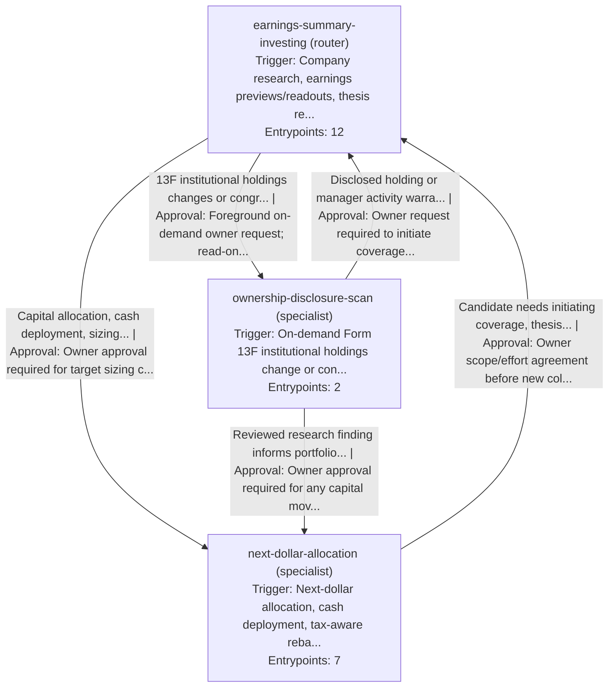

# Project skill map

Generated from tracked `agents/openai.yaml` routing metadata and [routes](routes.md). Do not edit by hand.

## Handoff diagram



## Skill waterfall and node details

```text
ROUTER: earnings-summary-investing (Earnings Summary Investing)
  +-> next-dollar-allocation [routes.md:yes]
      when: Capital allocation, cash deployment, sizing, tax-aware funding, or buy/add/trim/sell trade-offs
      approval: Owner approval required for target sizing changes, permitted sales, and trade execution
  +-> ownership-disclosure-scan [routes.md:yes]
      when: 13F institutional holdings changes or congressional PTR disclosure research
      approval: Foreground on-demand owner request; read-only scan with no DB writes or trade inference
FEEDBACK / CROSS-SKILL HANDOFFS FROM next-dollar-allocation:
  +-> earnings-summary-investing
      when: Candidate needs initiating coverage, thesis refresh, or DCF valuation update before sizing
      approval: Owner scope/effort agreement before new collection; explicit owner approval for thesis or DCF mutations
FEEDBACK / CROSS-SKILL HANDOFFS FROM ownership-disclosure-scan:
  +-> earnings-summary-investing
      when: Disclosed holding or manager activity warrants full company research or new-company evaluation
      approval: Owner request required to initiate coverage or add ticker to evaluation scope
  +-> next-dollar-allocation
      when: Reviewed research finding informs portfolio positioning or incremental capital allocation
      approval: Owner approval required for any capital move or constraint change

NODES:
- earnings-summary-investing [router]
  trigger: Company research, earnings previews/readouts, thesis review/revision, valuation, decision cards, ETF context, or portfolio risk
  inputs:
    - Approved theses (micro_thesis/holdings/<TICKER>.json)
    - Canonical SQLite research DB
    - Transcripts, IR documents, and SEC filings
    - Current roster (GET /api/work-os/portfolio, GET /api/work-os/evaluation)
  outputs:
    - Research artifacts, pre-earnings briefs, post-earnings readouts, decision cards, thesis amendment proposals, and DCF updates
  entrypoints:
    - execution/build_artifacts.py
    - execution/generate_pre_earnings_briefs.py
    - execution/generate_post_earnings_readouts.py
    - execution/build_investment_decision_card.py
    - execution/refresh_dcf.py
    - execution/dcf_sheets.py
    - execution/run_thesis_evaluator.py
    - execution/refresh_portfolio_risk_snapshot.py
    - execution/sync_sec_filing_inventory.py
    - execution/capture_expected_sec_documents.py
    - execution/ingest_sec_filing_xbrl.py
    - execution/backfill_transcripts.py
- next-dollar-allocation [specialist]
  trigger: Next-dollar allocation, cash deployment, tax-aware rebalancing, consolidating exploratory positions, or position sizing
  inputs:
    - Full holdings, cash, and account tax treatment (src/integrations/portfolio_tracker_v1.py, src/integrations/portfolio_allocation.py)
    - Recorded sizing intents and affirmed owner profile
    - Company theses, DCF readiness, and full-book risk context
  outputs:
    - One preferred tax-aware capital-allocation plan with funding sequence and before/after weights (privately saved when requested)
  entrypoints:
    - execution/review_position.py
    - src/integrations/portfolio_tracker_v1.py
    - src/integrations/portfolio_allocation.py
    - src/advisor/position_review.py
    - src/advisor/position_tax.py
    - src/allocation/book_risk.py
    - src/allocation/what_if.py
- ownership-disclosure-scan [specialist]
  trigger: On-demand Form 13F institutional holdings change or congressional Periodic Transaction Report scans
  inputs:
    - Bounded manager/member/ticker/window scope
    - Official SEC EDGAR 13F filings and House Clerk / Senate eFD disclosure records
  outputs:
    - Amendment-aware diff, claim-level official links, and per-target/chamber coverage receipts
  entrypoints:
    - src/advisor/skills/ownership-disclosure-scan/SKILL.md
    - src/advisor/skills/ownership-disclosure-scan/references/methodology.md
```

## Regeneration and validation

```bash
python3 scripts/check_investing_skill.py render-skill-map --write src/advisor/skills/earnings-summary-investing/references/skill-map.md
python3 scripts/check_investing_skill.py check-skill-map
```
